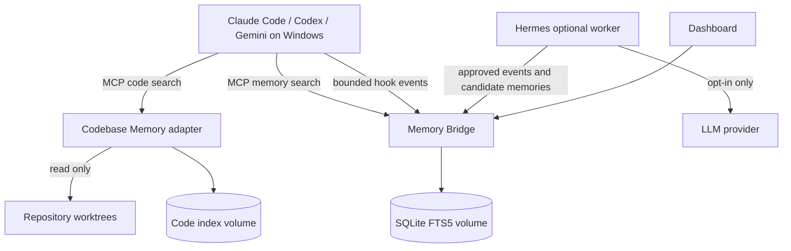

# Architecture v0.1

## Runtime topology

## Component contracts

- Codebase Memory: pin a verified upstream release, validate supported language and transport, mount explicitly registered worktrees read-only. If upstream offers stdio only, use a tested host launcher or dedicated transport adapter; do not assume HTTP support. Preserve index storage across container restarts. Resolve returned paths relative to the worktree; map back to Windows without path traversal. Validate freshness with commit and dirty-tree changes.
- Memory Bridge: Python FastMCP + FastAPI, SQLite FTS5, sole DB writer, explicit migrations, short bounded results. MCP stdio or Streamable HTTP according to tested client compatibility. Loopback-only host exposure, authentication for write/admin routes, no unrestricted path access.
- Hermes: upstream agent in a separately pinned container; optional batch worker uses bridge API, not direct SQLite writes. No model calls on queries. Only approved and redacted summaries may reach a configured provider. No repository mount or Docker socket by default. Verify upstream deployment and invocation contract before building worker integration.
- Dashboard: lightweight UI for project registration, health, search, review, reindex, backup and metrics; read-only by default. Implement after core integration.
- Host integration: merge (never replace) existing MCP and hook config. SessionStart checks branch/worktree; hooks capture bounded evidence and use timeouts; failure must not block editing. Claude reads current code before changes.

## Data model

Project: id, canonical remote or local identity, policy. Worktree: project_id, path mapping, branch, HEAD, dirty fingerprint. Memory: id, project_id, optional worktree_id, type, title, body, tags, source_agent, source_commit, evidence_ref, state (candidate/verified/superseded), created_at, updated_at, supersedes. Event: idempotency key, task_id, project_id, kind, bounded payload, timestamp. Metrics: query count, latency, result size, index freshness, measured token usage where available.

Only verified records are returned by default; distinguish current requirements from historical decisions. Do not treat untrusted stored text as instructions. Never overwrite conflicts silently. FTS retrieval must support Unicode and tests for Vietnamese queries; optional embeddings are deferred.

## Proposed MCP tools (custom bridge, not existing upstream tools)

- get_project_context(project_id, worktree_id)
- search_memory(project_id, query, limit, max_chars)
- get_handoff(project_id, task_id)
- save_task_result(project_id, task_id, evidence, idempotency_key)
- save_decision(project_id, summary, evidence, idempotency_key)

Default result budget: 5 records, 4,000 characters total; return provenance and explicit truncation. Write operations create candidates unless a trusted verification policy is satisfied.

## Deployment target

Docker Compose with persistent named volumes, separate networks as needed, non-root containers, healthchecks and memory limits. Start core services without Hermes/provider credentials. Keep host code writable only by host coding tools. Example target resource ceilings: Codebase 1.5 GB, Bridge 512 MB, Hermes 1 GB, UI 256 MB; measure and adjust. Never advertise limits as measured consumption.

## Acceptance

- Correct worktree-specific symbol results and Windows path mapping.
- Restart preserves memories and indexes; backup and restore tested.
- Different projects and branches cannot leak unrelated memory.
- Retrieval works with Hermes disabled and no external LLM key.
- Secrets ignored; no external transmission without explicit project policy.
- Benchmark comparable tasks with/without hub; distinguish measured input tokens, cache and estimated metrics.
